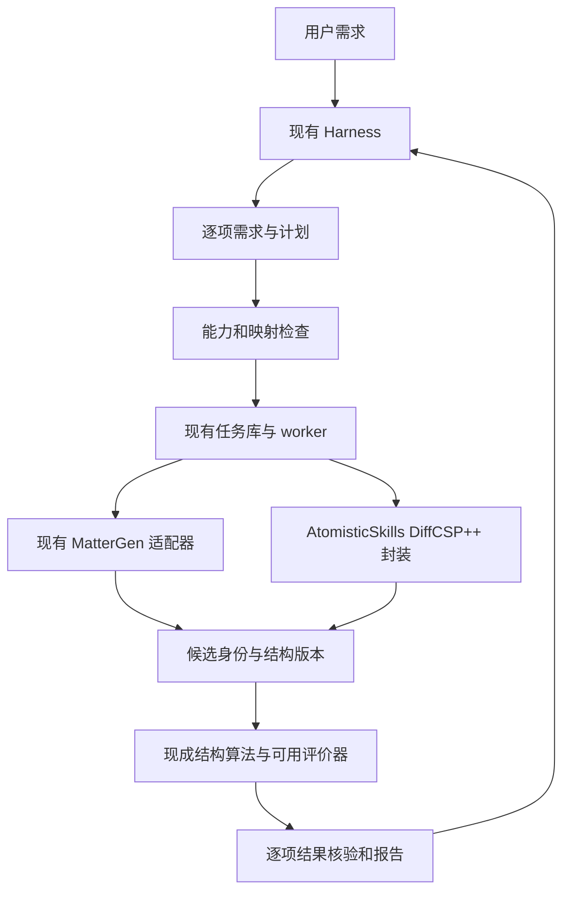

# 材策 MatPilot 研发方案 v1.1

修订日期：2026 年 10 月 21 日。用于替代 v1.0 的定位、第二模型选型与主实验安排；现有任务服务继续作为开发基础。MatPilot 暂作内部代号，公开命名前处理同领域重名问题。

本版建议将作品定位为**面向异构晶体生成工具的需求保持与候选证据核验插件**。直接采用已有生成模型、计算工具和科学算法，把研发重点放在一个具体问题上：用户提出的材料要求，经过模型选择、参数转换、生成、筛选和报告后，是否仍被完整保留，并且对应到正确的候选结构。

系统的应用价值是减少无效计算与错误解读。研究贡献取决于公平对照结果；插件形式、增加模型数量、中文界面和调用 DeepSeek 均不单列为创新。

## 修订依据与选择

AtomisticSkills 已提供插件包装、多个生成模型、科研技能、独立运行环境和评测资源。深度检查还发现，部分接口的参数优先级、候选身份选择和科学元数据核验需要调用方承担额外责任。本地 MatPilot 已有严格参数校验，但无法识别在结构化之前就遗漏的原文要求。[完整分析与复核记录](AtomisticSkills_深度复用分析_2026-10-21.md)

| 路线 | 判断 | 本版决定 |
|---|---|---|
| 自建通用材料智能体平台 | 范围大，与 AtomisticSkills 重合高 | 收缩 |
| 给现有工具增加中文入口或插件安装 | 可改善使用体验，独立研究新颖性弱 | 作为交付能力 |
| 需求到候选结果的持续校验 | 有具体错误来源，能沿用现有代码，能够开展配对实验 | 主线 |
| 自训练生成模型或宣称发现高性能催化材料 | 数据、算力和验证成本超出当前首版条件 | 首版不安排 |

本版不把“确定性规则”“证据链”本身称为首创。同类方法已有 LatticeMind 等相关工作。待验证的贡献限定在生成模型控制能力不同、生成结果具有随机性这一场景。[相关研究](https://arxiv.org/abs/2610.26869)

## 核心研究问题

主问题：相比具备正确文档和已修复局部缺陷的工具系统，增加逐项需求记录、参数映射检查和候选证据核验，能否降低语义错误及错误结论，同时保持可执行任务的完成率？

三个待检验假设：

1. 对每条要求明确任务语义和实际去向，可以减少元素集合与固定化学式混用、目标值与硬边界混用、模型切换后的条件丢失。
2. 将每条检查结果绑定到候选 ID、结构版本和评价方法，可以减少同化学式候选串用、不同方法数值混排、部分完成被表达为全部成功。
3. 在有限的能力目录内提供具体修改选项，可以比通用报错减少人工修正；这一项只在前两项完成后验证。

系统不得承诺自动理解任意自然语言。逐项原文对应、保守澄清和用户对计划的一次审阅用于降低遗漏风险；其有效性仍须通过独立语义标注评价。

## 首版范围

| 项目 | 修订安排 |
|---|---|
| 交互 | 继续使用 DeepSeek Harness 现有界面；MCP 是必要接口，不把宿主原生支持其他平台 Skills 格式作为前提 |
| 首模型 | 保留已有 MatterGen 适配器与官方调用方式，核验当前环境的真实小任务 |
| 第二模型 | 优先试用 AtomisticSkills 的 DiffCSP++ 封装；要求输入已核对的对称性规格或结构模板 |
| 第二模型替代 | DiffCSP++ 的权重、安装或小任务在限定选型时间内不通过时，改试 CrystalFormer；两者仍未就绪则降级为单模型验证版 |
| 计算能力 | 生成、结构解析、组成检查、结构等价去重；条件允许时增加一种机器学习势弛豫 |
| 科学性质 | 未配置并验证评价器的性质显示未评价；首版不承诺完整催化、腐蚀或合成性能验证 |
| 任务规模 | 默认 16 个采样，上限 32；首次联调可用 2—4 个。有效候选目标与最大采样预算分别记录 |
| 部署 | 轻量服务与计算环境隔离；优先 Linux worker，现有 WSL 方案可保留并独立验收 |
| 成果 | 两个模型的真实小任务、需求与证据检查模块、冻结任务集、对照结果、可演示插件 |

DiffCSP++ 的现有入口需要空间群与 Wyckoff 信息。只给化学式时不能自动编造这些信息；模板来源和推导过程需保留。选择它是为了复用已有封装和检验不同输入语义，不能因此声称两种生成模型的质量可直接比较。[上游入口](https://github.com/learningmatter-mit/AtomisticSkills/blob/6afdd465a35088136e4875d7d2fbaefc633f4adf/src/mcp_server/diffcsp_server.py)

## 用户可见的行为

示例需求：“在 Ni-Fe-O 体系中找候选，希望有较好的析氧活性，最多采样 16 个，不要把未经验证的性能写成结论。”

系统先展示一份简短计划：元素体系可以作为生成条件，但实际输出仍需检查；析氧活性保留为研究目标，当前没有适用评价器就标为未评价；16 是采样上限。完成后报告实际生成数、通过组成和结构检查的数量、具体候选文件，以及哪些性质尚未测定。若只得到 7 个合格结构，不能写成“已找到 16 个高活性材料”。

对于固定化学式任务，计划必须区分两条路径：使用具有相应输入能力的预测工具；或者经用户理解后采用生成再筛选的搜索过程。后者不能保证给定预算内获得足够合格候选。硬性结果要求仍由输出检查执行，不因换模型而消失。

用户只需在目标、预算或计算方案发生实质变化时确认。查询状态、读取已有结果和按已确认规则整理报告不重复请求确认。

## 需要自主实现的三个模块

### 逐项需求记录

每条要求保存 `requirement_id`、原文片段位置、标准化内容、约束类型、单位、强弱约定和最终去向。约束类型至少包括元素集合、化学计量、对称性、采样预算、数值目标、数值边界及研究目标。

每条要求可以有多个实施阶段，例如同时作为生成引导和生成后的检查；不能强制把一条要求只放进一个字段。对外汇总为可控制、需后验检查、需澄清或尚无验证方法，避免未支持要求被悄悄放进普通备注。

原文到记录由 LLM 提议，程序检查片段定位、字段合法性和明显的数值／元素遗漏，用户审阅计划。程序层覆盖率与人工判定的语义完整率分别统计，不能把“所有已有字段都有映射”当成“原文没有遗漏”。

### 需求到执行与检查的映射

每个模型能力卡声明输入语义、必需信息、允许条件组合、条件是引导还是保证、输出对象及适用的检查器。能力卡附代码版本、权重身份、来源链接和实际可用状态。

`prepare_plan` 生成每条要求对应的模型参数、检查方法或澄清问题。提交前检查：已有需求没有被丢掉；单位和含义保持一致；计算预算未扩大；需要后验检查的条件有适用方法；缺失科学评价方法时不承诺达标。

不匹配时，返回可以说明差异的选项，例如补充结构模板、更换模型、接受只做元素体系探索。首版在两种模型和少量允许变换内枚举选项，输出修改了哪些要求。避免一开始引入通用规划器、复杂优化器或自训练模型；也不把枚举结果宣传为数学意义上的全局最小修复。

### 候选身份与结果核验

生成结构、弛豫结构和评价结果分别建立记录。候选 ID 不用化学式代替；结构变换记录父子关系。文件哈希表示字节身份，结构等价由 pymatgen 等现成方法判断，两者不可混用。

每个指标保存结构版本、数值、单位、方法及权重身份、输入与原始输出位置、收敛状态和参照集。上游未知的元数据保持未知，不用默认值补成“已验证”。

每条候选要求给出通过、不通过或未知三种判定。报告分别显示执行状态、有效候选数量和研究目标验证状态。不同模型生成的候选可以用同一检查协议筛选；不同评价方法给出的能量等数值，不因单位一致就直接排名。

凸包算法采用现成库。接入前要将目标选择改为候选 ID，并检查目标和参照相的计算方法是否可比。结果描述限定于所用模型、参照集和近似条件；不能由凸包数值直接推出催化活性或可合成性。

## 架构和复用边界

向智能体保留原九个工具，不因接入上游十个服务就全部暴露。长任务由 MatPilot worker 启动选定的上游脚本或服务，并传入专属工作目录；MCP 请求立即返回 job_id。只给 MatPilot 管理的执行路径提供完整性保证；具有不受限制终端权限的宿主仍可能绕过该路径，首版不宣称沙箱安全保证。

| 现有文件或模块 | 调整 |
|---|---|
| `adapters/mattergen.py` | 保留条件、单位和组合校验；增加每条需求的映射记录，不直接换成上游快捷接口 |
| `service.py` | prepare_plan 产生覆盖报告；screen_candidates 和 build_report 使用候选身份与检查结果 |
| `store.py` | 增加需求、候选版本、指标记录；保留 plan_id、幂等键和事件记录 |
| `worker.py` | 保留独立批次执行；增加上游工具进程桥接与显式输出目录 |
| `structures.py` | 保留 CIF 解析；增加精确化学计量检查和现成结构匹配算法 |
| 新增 `requirements` 模块 | 原文片段、标准化需求及覆盖检查 |
| 新增 `evidence` 模块 | 候选身份、方法可比性、三值检查与受约束报告 |
| 新增 DiffCSP++ 适配器 | 复用上游加载与采样，适配计划和候选对象 |

首版不替换整个任务系统，不新建通用数据库查询平台，不重写科研算法，也不同时接入全部生成器和势模型。Atomate2 的远程作业管理留给确有 DFT 需求时采用。

## 主实验与创新成立条件

### 主比较

| 组别 | 配置 | 回答的问题 |
|---|---|---|
| U | 固定版本 AtomisticSkills，含正常技能说明 | 现有系统能达到什么水平 |
| U+ | U 加已发现的局部修复与明确错误处理 | 排除只靠修复已知缺陷获得优势 |
| M | U+ 的相同计算能力，加 MatPilot 需求和结果检查层 | 领域表示与持续校验是否有额外收益 |

U+ 至少处理条件覆盖的显式拒绝或保留、明确采样数量、候选 ID 选择和查询失败状态。修复差异公开，不能故意保留明显问题。三组使用同一宿主、LLM 版本、可用模型和计算预算；使用科学等价的说明，允许基线正常查阅文档，不刻意削弱其工具能力。

主实验不把不同宿主、不同 LLM 或不同科学模型的差异算作 MatPilot 增益。上游 benchmark 的旧镜像若用于复现，须使用其对应技能版本，不能与当前上游混用。

### 任务与评分

12 个开发题用于建立规则和调试，36 个测试题在规则稳定后封存。六类各 6 题：模型控制语义；单位及同义表达；缺失信息；条件组合冲突；候选身份与证据；部分结果与运行故障。全集中至少 8 个跨模型选择题，并保证至少 18 个初始可执行题，避免拒绝型任务主导结果。需要澄清的题使用固定、各组等价的用户回答。

标准答案标注必要要求、可接受执行与澄清方式、候选身份、允许的结论和禁止的结论。结合合理正例与领域专家整理的失败类型，不只使用针对已知代码缺陷构造的题。标注由材料相关人员复核；评分者尽量不知道组别。开发题、公开例题和正式测试分开保存。

每组每题重复 3 次，主实验共 324 次任务运行；同一题的重复不能当作独立样本。先用开发题实测 API 和人工评分成本，超出资源时减少非核心实验，不能事后只保留效果好的题或轮次。大部分执行采用相同的审定回放数据或模拟后端，另做真实模型验收；两类结果分别披露。

主要指标是完整任务正确率：需求语义正确、动作正确、候选对应正确、结论有适当证据才算成功。另报可执行题完成率、误拒绝率、要求遗漏率、错误启动率、无依据结论率，以及每个正确完成任务的人工时间、API 消耗和科学计算成本。失败任务保留在分母中，避免通过一概拒绝或无限重试取得好分数。

设置去掉需求映射、去掉结果核验两种消融，可先在固定的小任务子集进行。原 A／B／C 入口研究降为次要实验：只有主比较支持增益后，再验证多轮对话是否优于一次解析，以及是否减少用户操作。主实验未成立时，不继续堆叠交互评测。

### 预先约定的判断规则

以下是内部投入判断线，不是现有成绩、科学显著性标准或获奖保证：

- M 相比 U+，完整任务正确率目标提高至少 10 个百分点；同时报告按任务配对的差异和不确定区间。
- 可执行任务完成率下降超过 5 个百分点时，不认定整体改进；同步检查误拒绝和澄清负担。
- 若开发题上 U+ 已接近满分，则转看人工干预或成本，目标减少约 20%，并保留正确率；改变主要指标必须在正式测试前记录。
- 即使有限测试中严重错误为 0，也只表述为该测试范围内未观察到，不宣称零风险。
- 如果收益只来自一两个补丁、报告格式或少数已知题，按工程改进交付，不包装成通用新方法。

## 真实运行验收

两个生成模型都必须产生真实可解析结构并进入同一候选记录流程。至少安排 3 个小任务，覆盖两模型以及一种受支持的条件或模板变化；与演示固定样本、历史结果分开记录。模型选择正确不代表候选性质达标，任务完成也不等于生成成功找到目标材料。

先做每模型 2—4 个结构的小任务，检查环境、权重、命令、实际数量和停止行为，再决定后续采样预算。第二模型真实任务未通过时，不用模拟 adapter 代替多模型成果。

Ni-Fe-O 保留为演示需求，不把现有历史结构当作本次新生成结果。固定组成任务采用有来源的模板。若需要展示稳定性评价，优先用已有、方法一致的记录验收身份和单位链路，再单独安排实际计算；不为展示效果扩展全自动 DFT。

## 六周安排和停止条件

排期沿用单人每周约 12—18 小时的假设，约 72—108 小时；服务器和权重准备时间需单独确认。以下阶段以证据为出口，不以界面完成度计进度。

| 阶段 | 工作 | 出口与调整条件 |
|---|---|---|
| 第 1 周 | 冻结问题、上游版本和开发题；试运行两模型；建立 U+ 补丁清单 | 首模型真实小任务；第二模型是否可运行有明确结论。第二模型适配先给 8 小时有效投入窗口 |
| 第 2 周 | 实现需求记录、能力映射与澄清差异；保留原队列 | 原文要求有逐项去向；完整参数冲突与结构化前遗漏分开检查 |
| 第 3 周 | 候选身份、版本、指标与报告核验；第二模型接入 | 同化学式候选不串用；两个真实模型产物通过统一收集 |
| 第 4 周 | 跑开发题上的 U+／M 配对试验；小范围消融 | 若未见任务成功或操作成本收益，停止扩展，按工程插件收敛 |
| 第 5 周 | 冻结 36 题、提示与评分；执行主实验 | 保存全部失败和原始轨迹；独立复核语义与结论 |
| 第 6 周 | 真实案例、必要用户试用、结果分析和演示 | 可复查的版本、运行包、评测表和边界说明 |

第 1 周不具备 GPU／权重时，可继续需求与证据模块及 CPU 回放，但多模型成果仍待真实计算。第 4 周主要差异消失时，优先将可复用修复与小型插件完成交付，不继续增加模型或改用更大 LLM 掩盖问题。

## 交付清单

1. 保留九个工具的 MatPilot 服务，以及 MatterGen 与第二模型适配器。
2. 有来源和版本的两模型能力卡、需求对象与候选证据规范。
3. 独立环境启动配置、上游固定版本和第三方来源说明。
4. 12 个开发题、36 个封存题、独立评分规则与任务原始记录。
5. U、U+、M 对照及必要消融，包含误拒绝、失败、时间和成本。
6. 两模型真实运行包、一个完整演示流程与使用手册。

这份修订完成的是研发决策与实施规格。当前已完成上游源码核查和四项 CPU 隔离核验；需求记录模块、第二模型集成、GPU 联调及主对照实验仍属于下一阶段开发工作。
