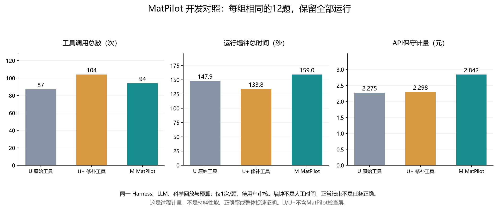

# MatPilot 插件作用与流程对比：r3 开发记录

记录日期：2026-10-22。版本：0.2.0.dev5。状态：真实语言模型已调用，材料模型真实计算关闭；公开开发题，待用户审核。

这轮证据支持的作用是：把需求约束、候选身份和结构检查接入可执行程序，使若干检查有明确的返回依据，并在具体任务中减少查询往返。它尚未证明整体提速、任务正确率提高或人工时间节省。全12题的实测中，M 的总墙钟、墙钟中位数和 API 核算金额均高于两个对照；以下完整保留这些不利结果。

## 对照对象和共同条件

| 组别 | 实际运行的实现 | 本比较中的作用 |
|---|---|---|
| U | 固定上游 AtomisticSkills 原始 server/wrapper 函数及正常技能 | 保留上游原始行为的参照 |
| U+ | 同一上游源码加已登记补丁，执行真实修补后的函数 | 区分通用包装器修复与 MatPilot 额外功能 |
| M | 同一 U+ 科学执行入口，加 MatPilot 需求映射、计划校验、候选检查与指标比较 | 观察插件集成层带来的作用和负担 |

这不是三套不同提示词冒充三套实现。三组使用同一语言模型、题干、固定澄清回复、正常上游技能全文、科学能力表、模板配置，以及绑定输入条件与有序采样的共享 CPU 回放。MatterGen 与 DiffCSP 的真实权重、CUDA 推理和真实性质评价均未运行；DiffCSP 的重型张量与对称性准备由已登记模板的 CPU 数据替代。所有结构和性质夹具明确标注 synthetic。

共同配置：DeepSeek Harness 0.2.1-rc.2；provider=deepseek-official；model=deepseek-flash；reasoning=off；每条最多12个turn、16次API请求、8192输出tokens、180000 ms。MatterGen guidance_scale=2.0、DiffCSP step_lr=1e-5。每题三组的硬采样预算相同，由对应夹具封顶；32是运行包的外层上限，不是每题都获得32次。允许模型在题目约束内选择实际调用与批次，所以相同预算不意味着实际工作量相同。

r3 在各子智能体内隔离了宿主继承的 MatPilot 生产执行说明和 MCP 资源说明，未改桌面主配置；三组均获题干范围内 CPU 回放与只读检查的共同预授权。M 另有其实际插件能力与研究执行说明，这是被比较的集成部分。研究只比较完整系统，尚未通过消融实验分离提示词、确定性校验和 LLM 各自的因果贡献。

## 数据来源与统计口径

完整公开证据：[r3 脱敏待审核包](../releases/0.2.0.dev5/MatPilot_development_review_r3.zip)；结构化汇总：[开发联调记录](../artifacts/study-harness-development-validation.json)。解压待审核包后，`metrics.json` 保存逐次来源审计和费用记录，`runs/<run_id>.json` / `.md` 保存公开题干、答复和工具返回。下文所有未注明 r2 的 run_id 均属于 r3。

本轮12道公开开发题，每组每题仅运行1次，共36条。36条 `result.outcome.status` 均为 `completed`，只表示 Harness 回合正常结束；原始 `correctness=ungraded`。未做独立人类评分，语义正确性仍待用户逐题审核，不能写成“36/36成功”“100%正确率”。人工操作时间为 `null`，未进行用户计时试验。

指标由全部36条最终 `result.json` 与 `trace.json` 自动汇总，并逐条核对 trace SHA256 与运行包身份；不排除拒绝执行、参数错误或部分结果。公开副本中对应字段为 `run.wall_seconds`、`run.api_accounted_cny`、`visible.tool_records`。

- API金额：采用运行器保守价格核算和保留预留额度的口径，不是供应商最终账单。本轮184次请求，合计7.415622元；不混入r1/r2或其他联调费用。
- 墙钟：采用 `result.outcome.wall_seconds`，包含宿主、LLM请求、工具与序列化开销；合计是各次运行时长之和，不是并发批次实际总历时，更不是GPU推理加速。
- 工具次数：`len(trace.tools)`，包括只读、澄清、规划和执行，不等于材料采样次数，也不等于API请求数。
- 错误调用：每条工具记录至多计1次；只计外层/解码返回的 `isError=true`、非空 `error`，或 `upstream_result.error` / `success=false`。计划正常返回 `blocked`、缺少固定澄清答复、候选不合格，以及注入的 `synthetic_timeout` 采样故障均不计入此列。这个计数不代表语义错误数。
- M另有10次 `prepare_plan`，其中4次返回 blocked：D0201、D0202、D0302、D0402。前两类计量必须分开看，不能用M“工具错误0次”宣称其没有提出错误方案。U/U+没有该规划接口，因此其规划阻塞数不适合作为0错误参照。

## 全量过程比较

| 组别 | 记录数 | API请求 | API核算金额/元 | 运行墙钟合计/秒 | 墙钟中位数/秒 | 工具调用 | 错误调用 |
|---|---:|---:|---:|---:|---:|---:|---:|
| U | 12 | 59 | 2.274840 | 147.912 | 11.596 | 87 | 4 |
| U+ | 12 | 60 | 2.298286 | 133.756 | 10.633 | 104 | 4 |
| M | 12 | 65 | 2.842496 | 159.031 | 12.732 | 94 | 0 |

M在这一轮没有显示整体提速或整体降费；工具总次数低于U+，但高于U。M的0次错误返回与对照各4次，是一个待进一步复测的过程现象，不是“错误率降低100%”的依据。部分任务停止于澄清、实际采样量也有差别，因此不能把全量时长比值直接称为等效工作提速率。



以下覆盖全部12题。每个单元格依次为 **API元 / 墙钟秒 / 工具次数 / 错误调用数**；金额保留6位、时间保留3位，合计使用未四舍五入的原值。run_id 规则：`题号--U--1`、`题号--Uplus--1`、`题号--M--1`。

| 题号 / 内容 | U | U+ | M |
|---|---|---|---|
| D0101 Fe-Ni-O / 析氧仅待评价 | 0.404610 / 15.608 / 18 / 0 | 0.466938 / 17.367 / 18 / 0 | 0.304768 / 14.480 / 8 / 0 |
| D0102 LiFePO4 缺少模板信息 | 0.130792 / 12.490 / 5 / 0 | 0.130000 / 10.369 / 7 / 0 | 0.110738 / 11.374 / 5 / 0 |
| D0201 1200 meV 引导目标 | 0.093070 / 8.906 / 3 / 0 | 0.241596 / 13.414 / 11 / 1 | 0.406928 / 16.539 / 12 / 0 |
| D0202 硬下界但没有评价器 | 0.092882 / 8.833 / 3 / 0 | 0.093738 / 8.839 / 4 / 0 | 0.198022 / 13.783 / 6 / 0 |
| D0301 已登记模板采样 | 0.140112 / 10.480 / 5 / 0 | 0.173408 / 10.787 / 6 / 0 | 0.282894 / 13.650 / 9 / 0 |
| D0302 固定澄清后无条件采样 | 0.277414 / 13.512 / 12 / 0 | 0.270426 / 15.357 / 14 / 1 | 0.432388 / 20.892 / 17 / 0 |
| D0401 NaCl 与 SG221 同时保留 | 0.288010 / 15.177 / 12 / 2 | 0.290038 / 13.398 / 13 / 2 | 0.348192 / 14.354 / 13 / 0 |
| D0402 元素集与带隙联合条件 | 0.130440 / 18.981 / 5 / 0 | 0.131076 / 10.616 / 7 / 0 | 0.144818 / 11.588 / 4 / 0 |
| D0501 仅报告 c_b 带隙 | 0.089502 / 6.467 / 3 / 0 | 0.089794 / 6.729 / 3 / 0 | 0.159670 / 10.357 / 5 / 0 |
| D0502 跨势能量不能直接排序 | 0.137930 / 10.701 / 7 / 0 | 0.145430 / 10.651 / 11 / 0 | 0.149310 / 11.663 / 6 / 0 |
| D0601 最多3次 / 每批最多1个 | 0.394688 / 16.583 / 11 / 2 | 0.142778 / 8.408 / 4 / 0 | 0.210560 / 11.815 / 6 / 0 |
| D0602 预算耗尽要求补采 | 0.095390 / 10.174 / 3 / 0 | 0.123064 / 7.823 / 6 / 0 | 0.094208 / 8.538 / 3 / 0 |

执行量也必须一起看：D0101三组均实际采样4次；D0201中U未采样，U+/M各采样1次；D0301、D0302、D0401三组各采样1次。D0102、D0202、D0402、D0602三组均未新增采样；D0501/2均为只读证据题。D0601的U/U+/M分别实际启动2/1/2次采样、均保留1个候选，不能将其耗时当成同等完成工作量。

## 哪些作用有实际工具证据

公开副本的工具序号以下均从0开始：`visible.tool_records[i]`。返回正文通常在 `result.content` 的 text 中，是可解码JSON；原始轨迹对应 `tools[i]`。

1. **把候选数量与合格、去重后的数量分开。** `D0101--M--1` 的工具索引5的 `check_candidates` 返回 `valid_candidate_count=3`、`unique_valid_candidate_count=1`；`records`显示c_c缺Ni，c_b/c_d与c_a重复。三组本题都采样4次，M用8次工具调用；U与U+各18次。对照答复仍将含FeO的两种结构称为有效独立候选，U还出现数量自相矛盾。M的优势证据是有可复核的筛选与去重字段，以及本题较少的查询往返；单题差异不能外推为普遍提速。

2. **从坐标作后验对称性检查。** `D0401--M--1` 工具索引7的 `check_candidates` 中，`records[0].requirement_checks` 对空间群返回 `expected=221, observed=221, status=pass`，方法为pymatgen SpacegroupAnalyzer，symprec=0.01 Å、角容差5°。U/U+答复主要依据CIF的P1导出标签否定221；共享坐标与M实际分析结果提供了进一步核对的依据。这里展示的是结构程序检查，不能据此称材料稳定或可合成。

3. **把不可比性判断变成显式工具结果。** `D0502--M--1` 工具索引5的 `compare_candidate_metrics` 返回 `comparable=false`，方法名为synthetic-potential-A/B，单位相同。U/U+也没有选择“更稳定者”，所以不能说只有M能识别该问题。可区别的作用是M有绑定具体metric_id、候选版本和方法身份的可审计判定。

4. **在执行前拦截模型自己提出的错误参数。** `D0202--M--1` 工具索引4的 `prepare_plan`：题干只有带隙硬下界，LLM却加入NaCl/221/cubic_nacl并尝试DiffCSP带隙条件；程序返回 `unsupported_condition`、`unverified_hard_requirement`、`unmapped_template`、`unmapped_condition`，之后未执行。它同时证明两件事：LLM会提出无依据方案；确定性层能在这个实例中挡住执行。不能把“被拦截”改写为“LLM理解完全正确”。

5. **拒绝条件冲突不再只靠最终措辞。** `D0402--M--1` 工具索引2的 `prepare_plan` 返回 `incompatible_conditions`，保留Fe-Ni-O和2 eV两个条件；本轮U/U+也停止，三组均未采样。M的增量是计划、原文锚点和拒绝原因的结构化记录，未显示该题独有的最终结论优势。

## 不利结果与仍需改进之处

1. **简单读取任务增加了步骤。** D0501三组均只报告c_b的synthetic 1.25 eV。U/U+各3次工具，M5次；M墙钟10.357秒，对照6.467/6.729秒，费用也更高。附加读取原始工件增加了证据检查，但不能包装成流程提速。

2. **需求台账有生成和修正成本。** `D0201--M--1` 工具索引3提交的研究目标文字与review_targets不一致，被 `unmapped_research_goal` 阻塞，工具索引4修正后才ready。`D0302--M--1` 工具索引6的 `prepare_plan` 把未含数字的引文用于batch_size，并把已解决澄清保留为阻塞；工具索引7修正后执行。D0302三组都得到同一固定答复且采样1次，M17次工具、20.892秒，高于U的12次/13.512秒和U+的14次/15.357秒。程序拦截有价值，但错误台账与额外往返仍是成本。

3. **流程描述仍可能被误放进科学目标。** r3的D0302与D0601中，M把无条件生成/不指定性能等文字登记成research_goal，随后报告该目标unknown。这不等于真的缺少材料性质评估；这种解释是否忠实于题意仍待用户审核，不能以台账存在证明语义完整。

4. **D0601不能用于宣称等量提速。** `D0601--M--1` 工具索引3的 `execute_plan` 请求3次/每批1个；`upstream_result.status=partial`、`sampling_attempts=2`、`num_generated=1`，第2次注入超时后U+包装器停止，`replay_status.remaining_budget=1`。U+仅请求1次就停止，剩余2次；U先误传Li-Fe-P-O被 `request_unavailable` 拒绝，随后实际启动2次，最后却把未进入采样的拒绝也算成已耗用预算，称剩余1次是记账bug。这个说法与返回的 `attempts_used=2` 及“已启动采样才扣预算”的协议不一致。三组没有超预算，但是否完整满足用户意图、是否应继续使用剩余额度，仍需结合题干审核。

5. **共同做对的事不能算成插件独有效果。** D0102三组均没有擅自补齐模板；D0402三组均未执行冲突条件；D0501三组均读取指定候选；D0502三组均未给出跨势能量排名；D0602三组均未超额补采。也不能因为M没有出现version_mismatch，就忽略其4次规划阻塞或最终文字的科学解释问题。

## r2开发史：保留失败，不混入r3效果

r2使用4096输出tokens，并仍受宿主继承生产指令影响；r3统一提高三组上限至8192、隔离继承段并更新批次上限契约。因此r2→r3不是仅切换插件的实验，不能用跨轮差异计算“插件提升”。r2原始记录保留在本地，未作为r3公开待审包中的运行冒充发布。

- r2 `D0601--M--1`：先伪造seed来源被拒，修正后仍因“每批最多1个”覆盖问题停止，0采样。修复明确支持batch_size的at_most并保留上下界语义，正反例回归通过；r3相同题已形成ready计划，但仍出现上文的部分结果。
- r2 `D0601--U--1`：实际采样3次并产生2候选，最终却以max-tokens失败；末尾为摘要样式文本，不能视为正常交付答复。r3统一上限适用于全部三组，没有只给M放宽。
- r2 `D0502--M--1`：工具正确返回不可比，最终文字却误说两条记录权重标识不同，实际均为synthetic-no-model-weights。该历史例说明程序证据并不自动保证最终叙述忠实，必须审核答复本身。

| r2本地记录 | 原始trace SHA256 |
|---|---|
| D0601--M--1 | 9105a66c1d2d7a57d3ec8fe19041f8886ccfa7335a58fee3d159091df707e8f4 |
| D0601--U--1 | b62f875ead61f375ea2ffe539b420597f94e877a6619cfb940a58cb124100af8 |
| D0502--M--1 | ffb38d594f5f5e925ba1942233812ca134e926e27962e0e1222e93f2cb4a5f26 |

## 竞赛说明中可直接使用的结论

> MatPilot把材料研究请求接入可检查的计划、上游工具和候选证据链。在同模型、同题目、同预算的12道公开开发题对照中，插件展示了候选去重与约束核验、坐标对称性检查、跨方法指标比较拒绝等具体作用，并在部分任务中减少了查询往返。全量记录同时显示：本轮插件组的总体耗时和API核算金额更高，尚不能宣称整体提速或正确率提高。当前结果只验证语言模型驱动的软件工作流，材料数据全部来自明确标注的CPU回放；语义结论待用户审核，人工时间与真实材料计算效果尚未测量。

后续要主张“降低使用门槛、节省操作时间”，需要用户按固定任务实测首次可完成时间、人工操作时长、必需专业输入数和实际纠错次数，并保留失败。要主张模型效果或单一模块贡献，还需要未用于开发的新题、多次重复和分别关闭需求映射/证据检查的对照。当前没有这些结果，不补写数值。

## 复核与重算

r3运行包SHA256：`40e87ecfbae4221a5ea582ba67d8563b7602d819880b965786fbaf0191519bda`。源码manifest SHA256：`0889b3b97c83ead3849d940bf168389a1d552962c4cf130a17fa80b17cc4f00b`。共享夹具SHA256：`fb81fe895472f5b113a394334fdb9cdd7738498f02c1ad5c1efdb1bfd3b3c192`。原始记录身份可由公开包 `run.source_hashes` 与 `metrics.json` 核对。

下面代码在解压公开待审核包的根目录离线运行，逐条重算表格的四项过程指标；不调用API、材料模型或评分器。`blocked`不算错误返回的口径在代码中显式保留。

```python
import json
from pathlib import Path

def body(tool):
    result = tool.get("result", {})
    try:
        return json.loads("".join(x["text"] for x in result.get("content", [])
                                  if x.get("type") == "text"))
    except (ValueError, TypeError, KeyError):
        return result

def error_return(tool):
    result, data = tool.get("result", {}), body(tool)
    upstream = data.get("upstream_result", {})
    return (result.get("isError") is True or data.get("isError") is True
            or bool(data.get("error")) or bool(upstream.get("error"))
            or upstream.get("success") is False)

for path in sorted(Path("runs").glob("*.json")):
    item = json.loads(path.read_text(encoding="utf-8"))
    run, tools = item["run"], item["visible"]["tool_records"]
    assert run["audit_status"] == "verified_record"
    assert run["human_active_seconds"] is None
    print(run["run_id"], f'{run["api_accounted_cny"]:.6f}',
          f'{run["wall_seconds"]:.3f}', len(tools),
          sum(error_return(tool) for tool in tools))
```
